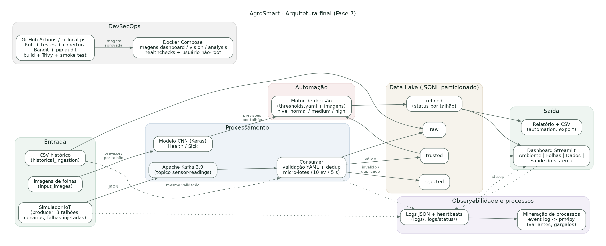
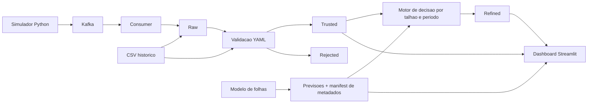

# AgroSmart - Entrega Final (Fase 7)

Plataforma de agricultura inteligente para cultivo de tomates: sensores IoT simulados, Kafka, Data Lake em
camadas, classificacao de folhas, motor de decisao, dashboard Streamlit, monitoramento, pipeline DevSecOps e
mineracao de processos.



## Novidades da Fase 7

| Requisito | Implementacao |
|---|---|
| Execucao automatizada | `docker compose --profile streaming up -d` sobe Kafka, consumer, simulador continuo (`sensor-simulator`) e dashboard, com healthchecks e reinicio automatico |
| Monitoramento | Logs JSON por componente (`logs/*.log`), heartbeats (`logs/status/*.json`), aba **Saude do sistema** no dashboard e `scripts/healthcheck.py` |
| DevSecOps | `.github/workflows/devsecops.yml` e `scripts/ci_local.ps1`: Ruff, testes + cobertura, Bandit, pip-audit, build Docker, Trivy (config e imagem) e smoke test |
| Seguranca | Containers sem root, dependencias atualizadas, riscos aceitos documentados em `security/RISCOS_ACEITOS.md` |
| Mineracao de processos | `scripts/build_event_log.py` (logs -> event log CSV/XES) e `scripts/process_mining.py` (pm4py: DFG, BPMN, variantes, gargalos, lead time) |

### Comandos principais

```powershell
docker compose --profile streaming up --build -d          # plataforma completa, execucao continua
docker compose ps                                          # status e healthchecks
docker compose logs -f data-lake-consumer                  # logs estruturados
docker compose --profile analysis run --rm process-mining  # mineracao de processos (output/process_mining)
powershell -ExecutionPolicy Bypass -File .\scripts\ci_local.ps1   # pipeline DevSecOps local
```

Dashboard: http://localhost:8501. Roteiro completo de execucao e evidencias: `docs/fase7/ROTEIRO_EXECUCAO.md`.

### Monitoramento

Cada componente grava logs JSON (uma linha por evento) e um heartbeat com contadores. A aba **Saude do
sistema** mostra o estado de cada componente (online, atrasado, offline, finalizado), eventos recebidos,
aceitos, rejeitados e duplicados, taxa de rejeicao, latencia de ingestao, tempo do ultimo micro-lote,
volume por camada do Data Lake, vazao por minuto e os logs recentes. Os healthchecks do Docker usam os mesmos
heartbeats, e o Compose reinicia servicos com falha.

Variaveis novas: `AGROSMART_LOG_DIR`, `AGROSMART_LOG_LEVEL`, `AGROSMART_HEARTBEAT_SECONDS`,
`AGROSMART_HEALTH_STALE_SECONDS`, `AGROSMART_HEALTH_OFFLINE_SECONDS`, `AGROSMART_SIM_INTERVAL`, `AGROSMART_SIM_SEED`.

### Simulador

```powershell
python -m src.streaming.producer --count 0 --scenario mixed --fields TALHAO-01 TALHAO-02 TALHAO-03 `
    --invalid-rate 0.05 --duplicate-rate 0.03
```

`--count 0` executa continuamente; `mixed` sorteia cenarios normal, random, dry, hot e high; as taxas injetam
leituras impossiveis e reenvios para demonstrar validacao e deduplicacao.

---

# Historico: Plataforma Integrada (Fase 6)

## Plataforma Integrada

O AgroSmart integra leituras ambientais simuladas, classificacao de folhas, processamento
em Data Lake e recomendacoes automatizadas em um dashboard Streamlit.

### Execucao Rapida no Windows

O painel e o pipeline de sensores nao precisam carregar TensorFlow. Python 3.11 ou 3.12:

```powershell
python -m venv .venv
.\.venv\Scripts\python.exe -m pip install -r requirements-dashboard.txt
.\.venv\Scripts\python.exe -m scripts.demo
.\scripts\start_dashboard.ps1 -Demo
```

Abra http://localhost:8501. A demonstracao usa `.demo/`, preserva os dados do sistema e
recusa substituir uma pasta nao vazia. Contem 72 leituras aceitas, uma rejeitada e tres
talhoes com niveis normal, medium e high. Para gerar outra demonstracao, escolha uma nova
pasta com `python -m scripts.demo --destination outro-diretorio` e configure os caminhos.

Alternativa Docker, depois de gerar `.demo/`:

```powershell
docker compose -f docker-compose.yml -f docker-compose.demo.yml -p agrosmart-phase6 up --build -d agrosmart
```

As previsoes das imagens sao reaproveitadas de `output/results.json`; os talhoes e datas
da demonstracao sao metadados simulados, identificados como `simulation`. Nao representam
nova execucao do modelo. A classificacao e binaria Health/Sick e nao diagnostica doencas.

### Integracao e Decisoes



O motor decide pela ultima leitura de cada talhao; as medias descrevem a janela de 24 horas
encerrada nessa leitura. Imagens so influenciam o mesmo `field_id` e essa janela temporal.
Imagens antigas sem identificador ficam sem associacao e nao elevam o risco dos talhoes.
O painel distingue a consolidacao operacional dos filtros historicos e sinaliza dados antigos.
Confianca do modelo nao e taxa de acerto. A taxa so aparece com rotulos explicitos no manifest.

O consumer consolida a cada 10 eventos validos ou 5 segundos, incluindo durante espera sem
mensagens; rejeitados nao incrementam o lote. Ctrl+C e `--max-messages` consolidam pendencias.
Offsets Kafka sao confirmados manualmente depois do processamento do lote. Na inicializacao,
o refinamento e reconstruido para recuperar uma interrupcao anterior. A entrega e pelo menos
uma vez: a deduplicacao protege `trusted`, mas `raw` pode conter reentregas.

Durante o streaming, apenas os talhoes afetados e suas particoes da janela recente sao lidos.
A inicializacao ainda carrega todos os IDs para deduplicacao; JSONL local e um unico consumer
sao o limite atual. Nao executar varias replicas de writers contra os mesmos arquivos.

### Imagens e Metadados

Para executar o modelo de classificacao, use Python 3.11 com `requirements.txt` ou o perfil Docker vision.
Associe imagens com um CSV de metadados contendo `image_path,field_id,captured_at,actual_label`.
`actual_label` e opcional; `captured_at` deve ser um timestamp ISO-8601 UTC.

```powershell
python src/predict_folder.py --in_dir input_images --out output/results.json
python src/prepare_data.py --metadata samples/image_metadata.example.csv
python src/automation.py
```

O arquivo de exemplo demonstra o formato; substitua seus metadados por associacoes verificadas.
Sem manifest, o preparo conserva a data de geracao da predicao e deixa o talhao sem associacao.
O preparo tambem atualiza `refined` uma vez, incorporando as novas imagens aos talhoes associados.
O relatorio usa o mesmo motor de decisao do dashboard, sem sorteio de diagnosticos.

### Dashboard e Exportacao

Abas Ambiente, Folhas e Dados; filtros compartilhados de talhao, periodo UTC e classificacao.
O painel atualiza os dados a cada 5 segundos. Mostra ultima leitura, medias, quatro series
ambientais, faixas operacionais do YAML, recomendacoes e motivos, imagens e exportacoes CSV.

```powershell
python -m scripts.export_dataset --out output/leituras_processadas.csv --fields TALHAO-01
python -m src.streaming.producer --scenario high --fields TALHAO-02 TALHAO-03 --count 10
python -m src.streaming.consumer --refine-every 10 --refine-seconds 5
```

Variaveis: `DATA_LAKE_PATH`, `AGROSMART_IMAGE_CSV`, `AGROSMART_THRESHOLDS_PATH`,
`AGROSMART_REFINE_EVERY`, `AGROSMART_REFINE_SECONDS`, `AGROSMART_STALE_SECONDS` (300 por padrao).
Sensores simulados: umidade do solo (%), temperatura do ar (C), umidade do ar (%) e luz (lux).
Cenarios do producer: random, normal, dry, hot e high; valores derivam do YAML.

### Docker e Verificacao

```powershell
docker compose --profile streaming up --build -d
docker compose --profile vision run --rm image-processing
.\.venv\Scripts\python.exe -m unittest discover -s tests -v
```

Dashboard e consumer usam a imagem leve; o modelo tem uma imagem separada. Kafka 3.9.0 tem
volume persistente e healthcheck. O consumer aguarda prontidao do broker. Nenhum processamento
de imagens bloqueia a inicializacao do painel. Configure `AGROSMART_DASHBOARD_PORT` se 8501
estiver ocupada. Use `docker compose -p nome-da-sprint` para isolar containers e volumes.

Verificacoes adicionais opcionais (Playwright nao e dependencia de producao):

```powershell
python -m pip install playwright
python -m scripts.verify_dashboard --browser 'C:\Program Files\Google\Chrome\Application\chrome.exe'
python -m scripts.verify_kafka
```

Os scripts de verificacao geram evidencias em `artifacts/`. O teste Kafka usa topico exclusivo,
mensagens validas, timestamp invalido, JSON malformado e duplicata, com Data Lake isolado.
Os artefatos da entrega estao em `docs/fase6/`, incluindo o resumo, diagramas, capturas,
dataset processado e decisoes automatizadas. A gravacao e publicacao do video ficam pendentes.

## Visao Geral

O AgroSmart e um prototipo de agricultura inteligente para cultivo de tomates. Ele combina:

- classificacao de imagens de folhas como `Health` ou `Sick`;
- leituras simuladas de sensores IoT;
- ingestao continua via Kafka;
- ingestao historica via CSV;
- armazenamento em camadas de Data Lake;
- indicadores consolidados para apoio a decisao no dashboard Streamlit.

## Estrutura Principal

```text
idea-seeders-agrosmart/
├── config/thresholds.yaml
├── dashboard/app.py
├── data_lake/
│   ├── raw/
│   ├── trusted/
│   ├── refined/
│   └── rejected/
├── input_images/
├── models/
├── output/
├── samples/
├── scripts/
│   ├── create_data_lake.py
│   ├── historical_ingestion.py
│   ├── sensor_consumer.py
│   └── sensor_producer.py
├── services/
│   ├── data_lake.py
│   └── sensor_validator.py
├── src/
└── tests/
```

## Camadas do Data Lake

- `raw`: eventos recebidos sem transformacao e arquivos historicos preservados.
- `trusted`: leituras validadas, tipadas, padronizadas e sem duplicidade.
- `rejected`: eventos rejeitados com os motivos da rejeicao.
- `refined`: indicadores consolidados por talhao, prontos para o dashboard.

## Configuracao de Thresholds

As faixas de sensores ficam centralizadas em `config/thresholds.yaml`.

- `allowed_range`: faixa fisica aceita pela validacao. Valores fora dessa faixa vao para `rejected`.
- `expected_range`: faixa operacional esperada para nivel de atencao e recomendacoes. Campos sem `expected_range` sao validados, mas nao geram alerta operacional.

O caminho do YAML pode ser alterado com a variavel `AGROSMART_THRESHOLDS_PATH`. A configuracao e carregada uma vez por processo; se o arquivo estiver ausente ou invalido, o sistema apresenta erro claro na inicializacao.

## Instalacao Local

```bash
py -3.11 -m venv venv311
venv311\Scripts\activate
pip install -r requirements.txt
```

Se aparecer erro com `self.async` ao importar `kafka`, existe um pacote antigo instalado no ambiente. Corrija com:

```bash
pip uninstall -y kafka
pip install --upgrade --force-reinstall kafka-python
```

## Fluxo de Imagens

```bash
python src/predict_folder.py --in_dir input_images --out output/results.json
python src/prepare_data.py
streamlit run dashboard/app.py
```

## Fluxo de Data Lake

A ordem recomendada para validar tudo do zero e:

1. criar a estrutura do Data Lake;
2. ingerir o CSV historico;
3. subir Kafka;
4. iniciar o consumer;
5. rodar o producer para enviar eventos simulados;
6. abrir o dashboard.

Criar a estrutura:

```bash
python scripts/create_data_lake.py
```

Ingerir CSV historico:

```bash
python scripts/historical_ingestion.py --csv samples/sensor_history.csv
```

Publicar leituras simuladas no Kafka:

```bash
python src/streaming/producer.py --bootstrap localhost:29092 --count 10
```

Consumir Kafka e gravar no Data Lake:

```bash
python src/streaming/consumer.py --bootstrap localhost:29092 --refine-every 10
```

Por padrao, o consumer fica rodando continuamente, esperando novas mensagens no topico Kafka. Para testes curtos, use `--max-messages` para encerrar automaticamente depois de uma quantidade definida:

```bash
python src/streaming/consumer.py --bootstrap localhost:29092 --max-messages 5
```

Nesse caso, abra outro terminal e envie a mesma quantidade de eventos:

```bash
python src/streaming/producer.py --bootstrap localhost:29092 --count 5
```

No streaming, a camada `refined` e recalculada em micro-batches: por padrao, a cada 10 eventos validos. Eventos rejeitados nao contam para esse lote. O valor tambem pode ser configurado pela variavel `AGROSMART_REFINE_EVERY`.

Os arquivos `scripts/sensor_producer.py` e `scripts/sensor_consumer.py` continuam existindo apenas como atalhos para os modulos em `src/streaming`.

Dentro do Docker, os servicos usam `kafka:9092`. Fora do Docker, use `localhost:29092`.

## Docker

Subir dashboard e Kafka:

```bash
docker compose up --build
```

Subir tambem o consumidor de streaming:

```bash
docker compose --profile streaming up --build
```

## Testes

```bash
python -m unittest discover -s tests
```
